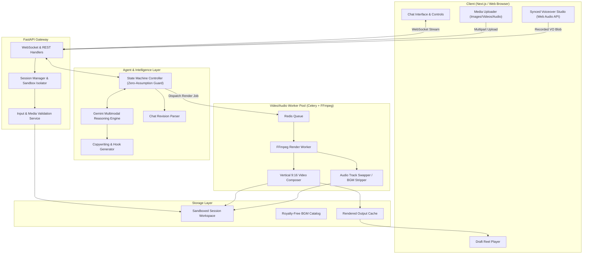
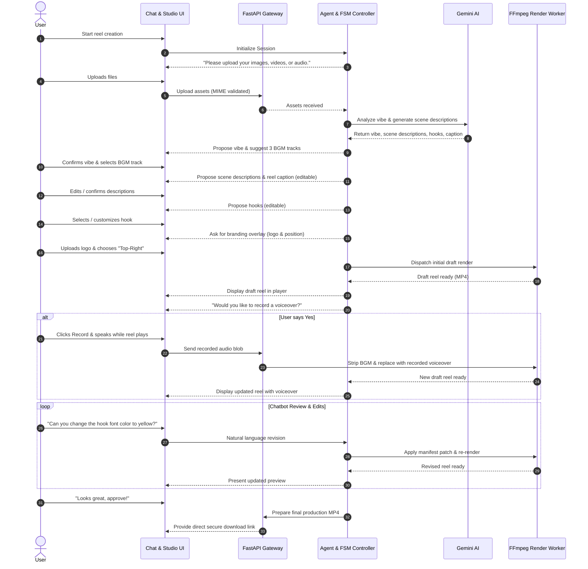

# Reel Creator Agent — System Architecture Design

## 1. Selected Tools & Technology Stack

Before exploring architectural details, the primary tools and frameworks selected for this solution are listed below:

| Layer | Selected Tools | Specific Responsibilities |
| :--- | :--- | :--- |
| **Multimodal Intelligence** | **Google Gemini 2.5 Flash / Pro** | Image & video keyframe analysis, vibe detection, BGM mood matching, hook generation, scene-by-scene captioning, and parsing user revision requests. |
| **Video Engine** | **FFmpeg 7.1 (via `imageio-ffmpeg`) + OpenCV + Pillow** | 9:16 vertical composition, Ken Burns pan/zoom for images, clip concatenation, text overlay rendering, watermark blending, and hardware-accelerated encoding. |
| **Audio Studio & Processing** | **Web Audio API + MediaRecorder + FFmpeg Audio Filters** | Browser-side reel-synchronized microphone recording, audio waveform capture, audio track replacement (complete BGM removal upon VO capture), loudness normalization. |
| **Application Backend** | **FastAPI / Starlette + Uvicorn + WebSockets / SSE** | Lightweight async API server, bi-directional streaming chat, session sandboxing, and media serving. |
| **Frontend Client (PWA)** | **Mobile-First Progressive Web App (HTML5, Tailwind, ES6)** | Responsive chat UI (optimized for 9:16 mobile screens & desktop), media uploader from camera roll, synchronized audio recording HUD, and PWA installable manifest (`manifest.json` + `sw.js`). |
| **Security & Validation** | **Python-magic / PureMagic + Pydantic v2 + Pathlib Sandbox** | True MIME type verification, strict JSON schema validation, input sanitization, and session directory sandboxing. |

---

## 2. Architecture Overview: Event-Driven FSM Agent

The architecture employs an **Event-Driven Agent with a Deterministic Finite State Machine (FSM)**. 

### Why not an unconstrained autonomous agent?
Video creation requires strict compliance with creative constraints, precise timing, and adherence to the user's explicit instructions. An unconstrained autonomous agent risks hallucinating default values (e.g., assuming a music track or branding position). By pairing **Gemini's multimodal reasoning** with a **Deterministic Dialogue State Engine**, we guarantee:
1. **Zero-Assumption Compliance**: The agent physically cannot transition to the render state until all required parameters have been explicitly answered by the user.
2. **Predictable Iteration**: Revision requests map directly to a versioned `VideoManifest.json` schema.



---

## 3. Subsystem Breakdown

### 3.1. Chatbot & Dialogue State Controller
- **Zero-Assumption Protocol**: The state controller maintains a strictly typed state object (`ReelSessionState`).
- The controller exposes interactive "Prompt Cards" inside the chat for user decisions (e.g., buttons for logo position: Top-Left, Top-Right, Bottom-Left, Bottom-Right).
- If the user types a free-form response, Gemini extracts the intent and fills the corresponding slot in `ReelSessionState`. If information is missing, the agent re-prompts immediately.

### 3.2. Multimodal Asset Analysis Service
1. **Keyframe Extraction**: For video assets, keyframes are sampled at scene changes or 1 fps using FFmpeg.
2. **Gemini Vision & Audio Prompting**:
   - Analyzes mood, color saturation, movement dynamics, and theme.
   - Extracts vibe tags: e.g., `["cinematic", "luxurious", "chill", "slow-paced"]`.
   - Proposes individual scene descriptions and an overarching story flow.

### 3.3. Creative Copywriting & Hook Generator
- Generates 3 hook variations tailored to short-form video engagement patterns (e.g., Question hook, FOMO hook, Story hook).
- Formats hooks for on-screen text overlays with safe margin areas (preventing overlap with Instagram/TikTok platform UI buttons).
- Generates ready-to-publish reel descriptions with relevant hashtags.

### 3.4. Video Assembly Pipeline (FFmpeg Engine)
The video assembly runs in isolated worker tasks that interpret a declarative `VideoManifest`:
```json
{
  "aspect_ratio": "9:16",
  "resolution": [1080, 1920],
  "scenes": [
    {
      "media_id": "asset_1.jpg",
      "duration_sec": 3.0,
      "effect": "ken_burns_zoom_in",
      "transition": "crossfade_0.5s"
    },
    {
      "media_id": "asset_2.mp4",
      "trim_start": 1.2,
      "trim_end": 4.5,
      "crop_mode": "center_fill"
    }
  ],
  "hook_overlay": {
    "text": "Stop scrolling! Here's how to...",
    "font_size": 48,
    "position": "center",
    "duration_sec": 3.0
  },
  "branding": {
    "file": "logo.png",
    "position": "top_right",
    "opacity": 0.85,
    "scale": 0.15
  },
  "audio_track": {
    "source": "bgm_chill_vibes.mp3",
    "volume": 1.0
  }
}
```

### 3.5. Synchronized Voiceover Studio & Audio Swapper
When the user indicates that a voiceover is required:
1. **Interactive Player Synchronized Recording**:
   - The frontend triggers the browser `MediaRecorder` API exactly when the video player starts playing.
   - The user records their voiceover while visually watching the draft reel.
   - Audio is encoded as uncompressed WAV / high-bitrate WebM/Opus and sent to the server.
2. **Audio Track Swapping**:
   - Per requirement, the backend FFmpeg process strips the existing background music track completely:
     ```bash
     ffmpeg -i draft_reel.mp4 -i user_voiceover.wav -c:v copy -map 0:v:0 -map 1:a:0 -shortest final_with_vo.mp4
     ```
   - The reel is re-rendered with the new voiceover track and immediately updated in the review player.

### 3.6. Conversational Review & Revision Engine
- When the user types feedback (e.g., *"Make the branding logo smaller and move it to top left"*, *"Change the hook text to 'Wait until the end...'"*), the agent uses Gemini to produce a JSON diff against the `VideoManifest`.
- Only modified filters or sequences are recalculated, speeding up draft generation.

---

## 4. Sequence Diagram: Complete End-to-End Flow



---

## 5. Security & Safety Architecture

1. **Sandboxed Media Processing**:
   - Each session is isolated in `/tmp/reel_sessions/<uuid4>/`.
   - File extensions are ignored for validation; media files are parsed with `python-magic` to confirm valid header signatures.
   - File upload size is capped (e.g., max 250MB total per session).
2. **FFmpeg Shell Injection Defense**:
   - Raw shell command execution (`shell=True`) is strictly prohibited.
   - All FFmpeg executions use typed parameter arrays with `subprocess.run(["ffmpeg", "-i", ...])` or `ffmpeg-python` bindings.
3. **Zero Assumption Validation Barrier**:
   - System prompt instructions explicitly forbid assuming defaults. If any parameter is undetermined, execution is blocked until user input is received.
4. **Data Retention & Privacy**:
   - Assets and rendered videos are automatically scrubbed via a cron worker after 24 hours.

---

## 6. Mobile-First PWA Implementation Architecture

### 6.1. PWA Manifest & Service Worker
- **`manifest.json`**: Configured with `display: "standalone"`, `orientation: "portrait"`, and vertical viewport meta tags so when users tap "Add to Home Screen" on iOS Safari or Android Chrome, the application runs full-screen without browser URL bars, feeling indistinguishable from a native app.
- **Service Worker (`sw.js`)**: Caches static shell assets (icons, stylesheets, scripts) for instant load times even over variable mobile cellular connections.

### 6.2. Touch-Optimized Chat & Ingestion Layout
- **Viewport Layout**: Fixed 100dvh (dynamic viewport height) design preventing mobile virtual keyboard jump issues.
- **Media Tray**: Horizontal swipeable carousel displaying uploaded photo and video thumbnails with drag-to-reorder touch gestures.
- **Editable Cards**: Conversational proposals (vibe tags, scene descriptions, hooks, caption) render as tap-to-edit cards with built-in character count indicators and instant confirmation pills.

### 6.3. Synced Voiceover Studio (Web Audio + MediaRecorder)
- Tap "Record Voiceover" triggers a full-screen vertical 9:16 video playback HUD.
- Microphone permissions requested cleanly with fallback guidance for iOS Safari audio constraints (`AudioContext` unlocked via explicit user touch event).
- Visual live audio VU meter / waveform rendered over the video player during recording.
- Real-time stop trigger when the reel finishes playing, immediately uploading the synchronized audio blob for BGM replacement.


